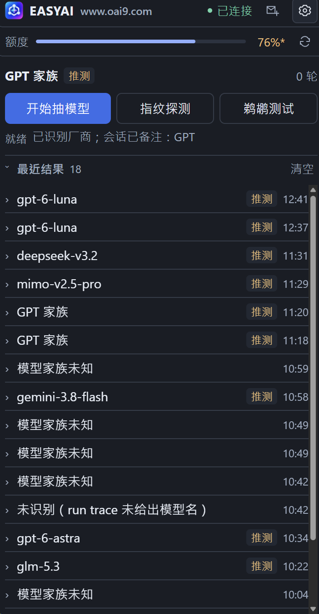
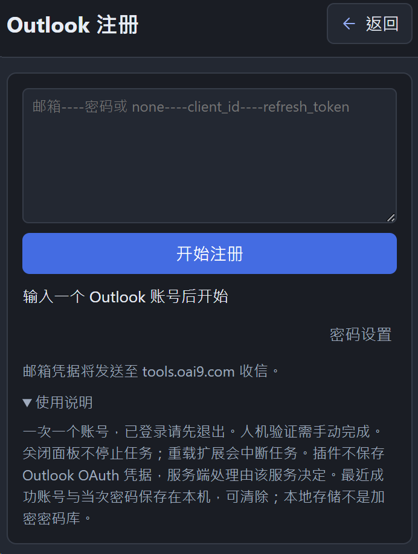
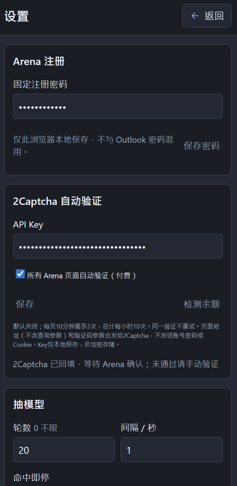

# EASYAI · Arena Tools

适用于 Arena.ai 的独立浏览器插件，基于 TypeScript + WXT。

- 网站：http://www.oai9.com
- QQ 交流群：**1053996918**（插件主页底部点击复制）
- 手动查看邮箱：https://tools.oai9.com/outlook-mail

> 此仓库仅包含浏览器插件与它运行所需的 JavaScript、图标和指纹数据，不包含 Rust 工程，也不需要安装或运行桌面程序。非 Arena 官方项目。

## 功能

- 自动抽模型、按工具调用识别厂商、三题指纹探测与会话备注。
- 额度查询、鹈鹕测试、可滚动的最近结果列表。
- 使用现有 Outlook 邮箱进行单账号 Arena 网页注册；收信、验证及设置密码。
- 最近一次成功注册信息在页面底部显示，可显示密码、分别复制、合并复制或清除。
- 可选的 2Captcha 自动验证，默认关闭，可在设置中保存 Key 并检测余额。

## 界面截图

**插件主页**



**账号注册页面**



**插件设置页面**



## 环境与安装

需要 **Node.js 22+** 与 npm。

```sh
git clone https://github.com/suyancc/easyai-arena-tools.git
cd easyai-arena-tools
npm ci
npm run compile
npm test
npm run build:all
```

`npm ci` 会准备 WXT 类型。构建脚本只使用仓库内的资源，不读取相邻项目。约 20 MB 的离线指纹数据是必需运行资源，已随仓库提供；构建时会校验其 SHA-256。

### 加载到浏览器

| 浏览器 | 命令 | 加载目录 |
| --- | --- | --- |
| Chrome | `npm run build:chrome` | `.output/chrome-mv3` |
| Edge | `npm run build:edge` | `.output/edge-mv3` |
| Firefox 128+ | `npm run build:firefox` | `.output/firefox-mv3` |

Chrome / Edge：在扩展管理页开启开发者模式，选择“加载已解压的扩展程序”。Firefox：通过 `about:debugging` 临时加载对应目录中的 `manifest.json`；长期分发需遵循 Firefox 签名要求。

Roxy 可尝试加载 Chromium 构建，但兼容性需在实际版本上验证。更新后重新加载扩展，并刷新已经打开的 Arena 标签页。

### 其他命令

```sh
npm run dev          # Chrome 开发模式
npm run dev:edge
npm run dev:firefox
npm run zip:all      # 打包构建产物；不会自动上传或发布
```

## Outlook 注册

1. 在“设置 → Arena 注册”中填写并保存 **Arena 注册密码**。
2. 打开顶部“Outlook 注册”入口，输入一条邮箱信息：
   `邮箱----密码或 none----client_id----refresh_token`
3. 点击开始，允许 `tools.oai9.com` 收信权限。

**仓库不内置可用注册密码。未设置时会阻止启动，不会替你使用共享密码。** 第二段 Outlook 密码仅为输入格式兼容，不用于 Basic Auth；实际收信使用 OAuth 信息。

插件通过 `POST https://tools.oai9.com/api/outlook/messages` 收信，邮箱协议由该服务处理。邮箱 OAuth 凭据会发送给该服务；插件本身不保存或记录它们，但不能保证服务端的日志/保存策略。不要使用你不信任的邮箱服务。

预检后才打开注册页面；只读取本次提交后、当前收件人的新邮件，并校验官方验证链接。遇到不确定的提交结果不盲目重复提交。新标签页共享当前窗口的登录状态，已有登录需手动退出；插件不会删除 Cookie 或强制登出。

注册成功记录包含邮箱和**当次实际使用的密码**，保存在浏览器本地，可清除。失败或停止不会生成成功记录。配置密码与成功记录均不是加密密码库，请注意设备安全。

## 2Captcha（付费，可选）

在“设置 → 2Captcha 自动验证”填写 API Key，保存并授权 `api.2captcha.com`，可先检测余额。勾选“所有 Arena 页面自动验证”并保存后生效；关闭开关立即取消本地等待。

- 只作用于 Arena 页面，不作用于其他网站；默认关闭。
- 支持能唯一定位回调的 reCAPTCHA v2 / v2 Enterprise；不猜测 v3 参数。无法可靠识别时提示人工处理，不创建收费任务。
- 同一验证不重复提交；每标签页 10 分钟最多 3 次尝试，全局每小时最多 10 次。
- DOM 事件触发检测，空闲时不定时轮询；平台任务进行期间每 5 秒查询一次，最多等待 5 分钟。
- 页面右下角显示进度与停止按钮。关闭/导航标签页、关闭开关、停止对应插件任务可取消本地等待；**已提交的平台任务可能仍收费，停止不保证退款**。
- 向平台发送去掉查询参数和片段的 Arena 地址、sitekey 与验证码参数；不发送账号密码、Outlook OAuth 凭据或 Cookie。API Key 仅本地保存，后台使用，不发送到 Arena 页面。

使用前请确认你有权进行相应操作，并遵守平台规则。自动识别及第三方解题均不保证成功。

## 项目结构

```text
entrypoints/          浏览器后台、内容脚本和侧栏
utils/                流程、收信、验证、指纹等模块
public/injected/      页面脚本（随仓库提供）
public/fingerprint/   固定版本指纹数据、来源说明与 MIT 许可证
public/icon/          插件图标
scripts/              独立资源校验/生成与离线诊断工具
tests/                单元和合成 DOM 合同测试
```

## 隐私与提交检查

不要提交 API Key、邮箱四段凭据、真实账号密码、HAR、Cookie、验证链接、浏览器配置或诊断日志。它们可能包含可登录账号的信息。`.gitignore` 已排除常见敏感文件和生成物，但不能替代人工检查。

`node_modules/`、`.wxt/`、`.output/`、压缩包和原始 HAR 不在源码仓库内。测试使用虚构凭据，不包含真实账号信息。

测试、离线浏览器模拟及构建通过不等于真实 Arena / Microsoft / Roxy / 2Captcha 端到端验证，也不能证明实际付费验证通过率。报告问题时仅提供脱敏状态或错误码，不要直接上传完整 HAR 或凭据。

第三方来源和许可证见 [THIRD_PARTY_NOTICES.md](THIRD_PARTY_NOTICES.md)。本项目尚未指定整体开源许可证；第三方资源保留各自许可。
